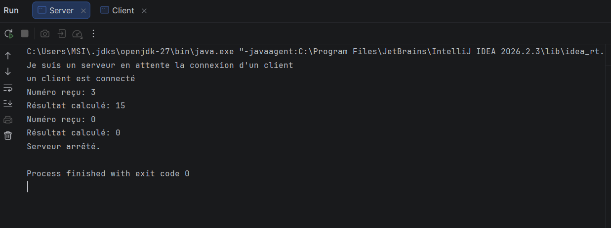
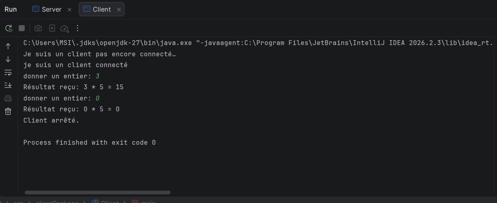
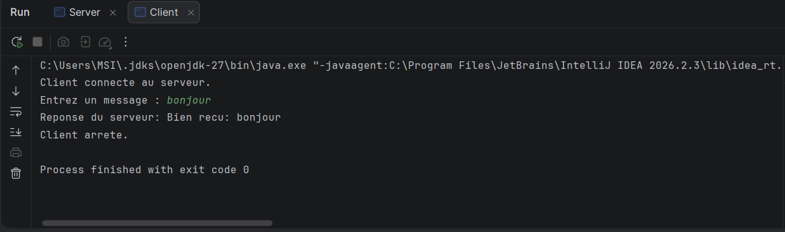
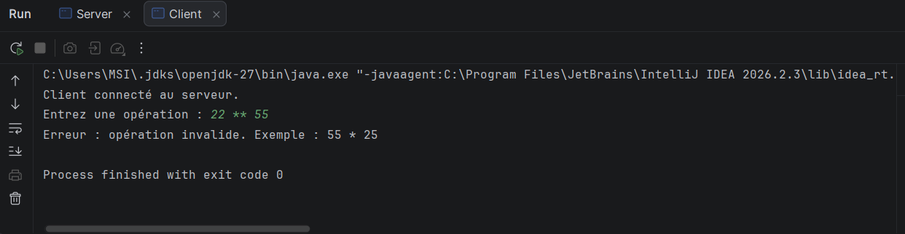
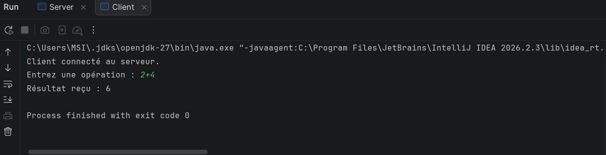

# TP 2 : Les sockets en mode connecté TCP : E/R de CC & objets

## Membres du groupe

- Ben Maalem Yassine
- LSI3 3 G2

---

## Activité 1-2 (Rappel TP1) : Échange d'entiers

Pour rappel, dans le TP1, le client et le serveur échangeaient un seul type de données (des entiers) pour effectuer une multiplication par 5. Les classes `DataInputStream` et `DataOutputStream` étaient utilisées.

### Capture d'écran du serveur (TP1)

### Capture d'écran du client (TP1)

### Interprétation
Le client envoie un entier au serveur via `writeInt()`, le serveur le reçoit via `readInt()`, calcule le résultat et le renvoie. Cette méthode est limitée car elle ne permet pas d'envoyer des chaînes de caractères ou des opérations complètes.

---

## Étape 1 : Migration vers les flux de caractères (CC)

### Objectif
L'objectif de cette première étape est de remplacer les flux de données binaires par des flux de traitement de chaînes de caractères (`BufferedReader` / `PrintWriter`). Cela permet d'envoyer et de recevoir du texte.

### Test de la migration
Pour tester cette migration, le client envoie un simple message texte ("bonjour") et le serveur le réceptionne.

### Capture d'écran du test

### Interprétation
Le client saisit la chaîne de caractères "bonjour" et l'envoie au serveur avec la méthode `println()` de la classe `PrintWriter`. Le serveur la reçoit avec la méthode `readLine()` de la classe `BufferedReader`. L'échange de texte fonctionne parfaitement.

---

## Étape 2 : Envoi d'une opération complète

### Objectif
Le client doit maintenant pouvoir envoyer une opération mathématique complète sous forme de chaîne de caractères (par exemple : "55 * 25" ou "2 + 4"). Le serveur analyse cette chaîne, extrait les opérandes et l'opérateur, calcule le résultat et le renvoie au client.

### Fonctionnement côté serveur
Le serveur utilise les expressions régulières (Regex) avec les classes `Pattern` et `Matcher` pour vérifier le format. Il supporte les 4 opérations : `+`, `-`, `*`, `/` et gère la division par zéro.

### Captures d'écran des tests

### Interprétation
Le serveur reçoit correctement les chaînes, parvient à extraire les nombres et les opérateurs, effectue le calcul mathématique correspondant, et renvoie le résultat sous forme de texte au client.

---

## Étape 3 : Validation de la syntaxe

### Objectif
Pour éviter d'envoyer des données incorrectes au serveur, une validation de la syntaxe a été ajoutée **côté client** avant l'envoi. Cette validation empêche l’envoi d’une chaîne incorrecte comme `22 ** 55` ou `abc + 3`.

### Fonctionnement
Le client utilise une expression régulière pour vérifier la saisie de l'utilisateur.
- Si la syntaxe est correcte (ex: `22 * 55`), l'opération est envoyée au serveur.
- Si la syntaxe est incorrecte (ex: `22 ** 55`), le client affiche un message d'erreur local et bloque l'envoi. La chaîne n'arrive jamais au serveur.

### Interprétation
Grâce à cette vérification locale, le serveur est protégé contre les chaînes de caractères mal formatées. Le client garantit que seules les opérations valides sont transmises sur le réseau TCP.

---

## Résultat de l'activité

Le service de calculatrice a été amélioré avec succès. Le client et le serveur peuvent désormais échanger des chaînes de caractères (CC) grâce aux classes du package `java.io`. Le client peut envoyer des opérations complètes et la validation de la syntaxe garantit que seules les requêtes correctement formatées sont traitées par le serveur.